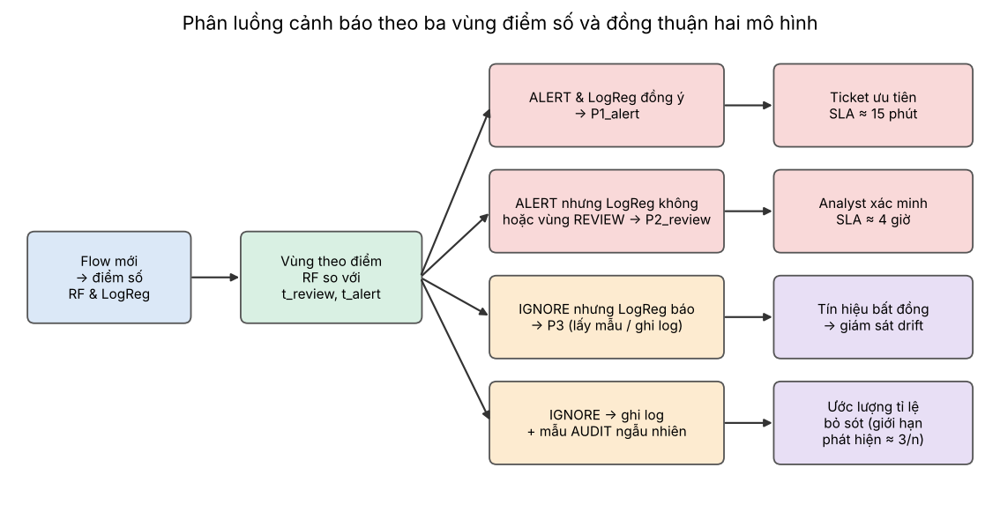

# Luồng xử lý dữ liệu và thực nghiệm

## 1. Luồng dữ liệu
```
data/input/*.parquet
   │  load_raw(): chuẩn hoá nhãn, ép float32
   ▼
make_splits(): train 60% / val 20% / test 20% (stratified theo Benign/FTP/SSH)  → data/output/processed/splits.npz
   │
   ├── train ──► Pipeline.fit()  [Inf→NaN → impute median → bỏ cột hằng → (log+chuẩn hoá nếu LogReg) → mô hình]
   ├── val   ──► chọn ngưỡng: operating (max F1), t_alert (precision mục tiêu), t_review (recall mục tiêu), t_min_cost
   └── test  ──► báo cáo cuối (một lần): precision/recall/F1/FP ở nhiều điểm vận hành
                 │
                 └── mẫu 40.000 flow ──► drift_scenarios ──► data/output/drift_data/*.csv.gz
```

## 2. Các điểm vận hành (operating points)
| Tên | Cách chọn | Ý nghĩa |
|---|---|---|
| default_0.5 | cố định | Tham chiếu |
| operating | ngưỡng tối đa F1 trên validation | Phát hiện cân bằng P/R |
| t_alert | thấp nhất sao cho precision(validation) ≥ mục tiêu | Vùng ALERT tin cậy cao |
| t_review | cao nhất sao cho recall(validation) ≥ mục tiêu | Ranh giới vùng REVIEW cho người |
| min_cost | cực tiểu chi phí FN×c_fn + FP×c_fp | Cân theo chi phí |

## 3. Kịch bản drift (`src/simulation/drift_scenarios.py`)
| Kịch bản | Biến đổi | Loại drift |
|---|---|---|
| `covariate_network` | Nhân đặc trưng thời gian (Duration/IAT/Active/Idle) của mọi flow với k~lognormal(median 2), chia các đặc trưng tốc độ (…/s) cho cùng k | Covariate shift |
| `prevalence_low` | Giữ benign, lấy mẫu lại tấn công còn 0,5% | Prior shift |
| `evasion_low_slow` | Chỉ flow tấn công bị kéo giãn thời gian (median ×8) | Concept drift |
| `combined` | Cả ba | Kết hợp |

Tập `control` (không đổi) kiểm tra rằng giám sát không báo động sai.

## 5. Giám sát
- **Không nhãn:** PSI/KS từng đặc trưng (tham chiếu = validation), PSI theo dải điểm [t_review, operating, t_alert], tỉ lệ dự đoán tấn công so với baseline.
- **Có nhãn (trễ):** F1 so với control; giảm hơn `f1_drop_trigger` → DEGRADED.
- **Tổng hợp:** `silent_failure = không nhãn báo STABLE nhưng hiệu năng DEGRADED`.

## 6. Hàng đợi con người


Chi tiết SLA, checklist và kiểm soát sai sót: `hitl_sop.md`.

## 7. Vòng đời
1. `train_models.py`: v1 → quality gate → production.
2. `monitor_drift.py`: phát hiện suy giảm.
3. `retrain_and_version.py`: so sánh (giữ v1) / (v1 + chỉnh ngưỡng) / (v2 retrain); gate: tốt hơn trên drift, không thoái lui quá `max_regression` trên dữ liệu gốc, đạt ngưỡng tối thiểu → promote; rollback drill.
