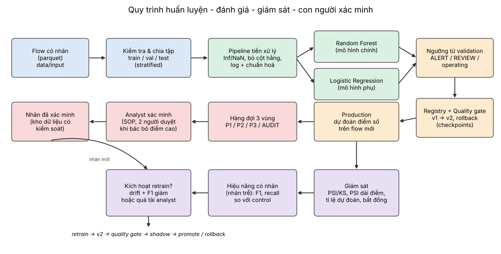

# Kiến trúc hệ thống



## 1. Các khối chính
| Khối | Mã nguồn | Vai trò |
|---|---|---|
| Dữ liệu & chia tập | `src/preprocessing/data_loader.py` | Đọc parquet/csv, chuẩn hoá nhãn, chia stratified, lưu chỉ số chia |
| Tiền xử lý | `src/preprocessing/feature_pipeline.py` | Inf→NaN, impute, bỏ cột hằng, log có dấu, chuẩn hoá (nằm trong Pipeline) |
| Mô hình | `src/models/model_builder.py` | Logistic Regression (tuyến tính, dễ giải thích), Random Forest (phi tuyến) |
| Khám phá mô hình | `src/models/model_inspector.py` | Cột được giữ, đặc trưng quan trọng |
| Registry & nạp mô hình | `src/models/model_registry.py`, `model_loader.py` | Versioning, stage, rollback, hash mô hình/dữ liệu |
| Huấn luyện | `src/training/trainer.py` | Train, chọn ngưỡng trên validation, quality gate, retrain |
| Đánh giá | `src/evaluation/metrics.py`, `thresholds.py` | Precision/recall/F1/FP, Bayes theo prevalence, 4 chiến lược ngưỡng, chính sách 3 vùng |
| Giám sát | `src/monitoring/drift_detector.py` | PSI, KS, PSI theo dải điểm, tổng hợp trạng thái |
| Mô phỏng drift | `src/simulation/drift_scenarios.py` | 4 kịch bản drift có kiểm soát |
| Human-in-the-loop | `src/hitl/triage.py` | Hàng đợi, mô phỏng analyst, audit, khối lượng, ngưỡng vừa sức |
| Trực quan & lưu kết quả | `src/visualization/` | Hình PNG; JSON/CSV/Markdown |
| Cấu hình | `configs/config.yaml`, `src/config.py` | Mọi tham số thực nghiệm |

## 2. Nguyên tắc thiết kế
1. **Không rò rỉ dữ liệu:** mọi bước tiền xử lý học từ train trong Pipeline; ngưỡng chọn trên validation; test chỉ để báo cáo.
2. **Tái lập:** seed trong config; hash dữ liệu huấn luyện, hash file mô hình, phiên bản thư viện lưu trong `metadata.json`.
3. **Tách thư viện và thực nghiệm:** `src/` không chứa đường dẫn cứng hay logic chạy; `experiments/` gọi thư viện.
4. **Mọi con số trong báo cáo được sinh từ lần chạy** (`experiments/build_report.py`), không gõ tay.
5. **Con người là một thành phần của hệ thống**, không phải bước phụ: có SLA, kiểm soát sai sót, vòng phản hồi nhãn.

## 3. Registry (checkpoints)
```
data/output/checkpoints/
├── registry.json                    # chỉ mục các phiên bản + stage
└── <model>/<vN>/
    ├── model.joblib                 # sklearn Pipeline đầy đủ (tiền xử lý + mô hình)
    └── metadata.json                # metric, ngưỡng, hash dữ liệu/mô hình, phiên bản cha, môi trường
```
Stage: `staging` → `production` → `archived`. `promote` tự đưa bản production cũ về `archived`; `rollback` quay về bản archived gần nhất.

## 4. Liên hệ lý thuyết ↔ hiện thực
| Chủ đề lý thuyết | Thực nghiệm | Mã nguồn |
|---|---|---|
| Dữ liệu, mất cân bằng, leakage | EDA, chia tập, pipeline | `inspect_data.py`, `src/preprocessing/` |
| 2 mô hình + precision/recall/F1/FP | LogReg vs RandomForest, nhiều điểm vận hành | `train_models.py`, `compare_models.py` |
| Base-rate, false positive | Ngoại suy precision, khối lượng analyst | `tune_alert_policy.py` |
| Drift | 4 kịch bản, PSI/KS, hiệu năng có nhãn | `generate_drift_data.py`, `monitor_drift.py` |
| Ngưỡng + HITL | Chính sách 3 vùng, hàng đợi, mô phỏng analyst | `tune_alert_policy.py`, `src/hitl/` |
| Lifecycle, versioning | Registry, gate, retrain, rollback | `retrain_and_version.py`, `model_registry.py` |
| Nhiễu nhãn / poisoning (khái niệm) | Đảo nhãn trong train sạch | `label_noise_experiment.py` |
