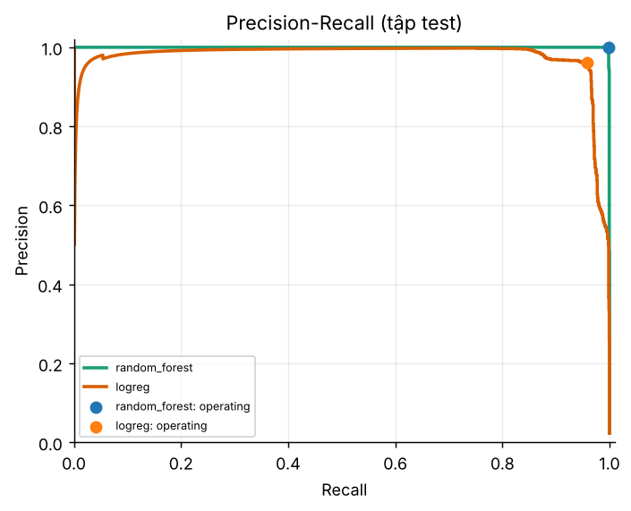
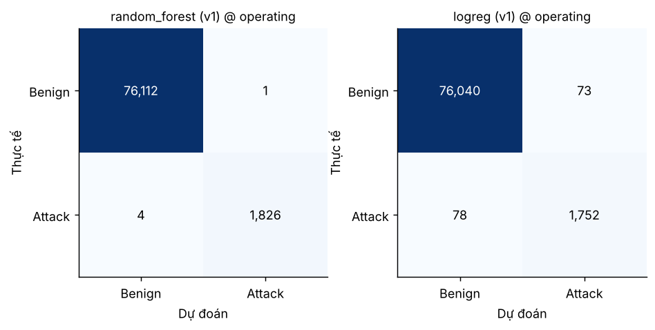
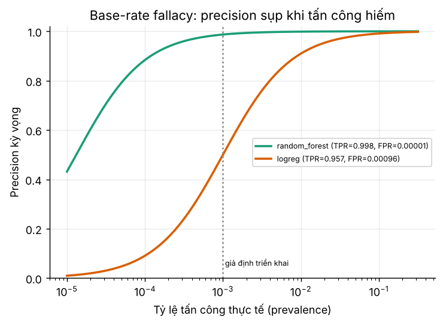

# Kết quả đánh giá mô hình (sinh tự động)

## 2. Hai mô hình cơ bản - đánh giá trên tập test

Mô hình: **random_forest** (mô hình chính) và **logreg** (mô hình phụ). Ngưỡng ‘operating’ = ngưỡng tối đa F1 chọn trên **validation** (không chọn trên test).

| Mô hình | Ver | Điểm vận hành | Ngưỡng | Precision | Recall | F1 | FP | FN | FP/100k flow | Accuracy |
|---|---|---|---|---|---|---|---|---|---|---|
| random_forest | v1 | default_0.5 | 0.5000 | 1.0000 | 0.9951 | 0.9975 | 0 | 9 | 0.0000 | 0.9999 |
| random_forest | v1 | operating(F1-max on val) | 0.4113 | 0.9995 | 0.9978 | 0.9986 | 1 | 4 | 1.2830 | 0.9999 |
| random_forest | v1 | t_alert | 0.4113 | 0.9995 | 0.9978 | 0.9986 | 1 | 4 | 1.2830 | 0.9999 |
| random_forest | v1 | t_review | 0.1539 | 0.9341 | 0.9995 | 0.9657 | 129 | 1 | 165.5056 | 0.9983 |
| random_forest | v1 | min_cost | 0.2199 | 0.9781 | 0.9984 | 0.9881 | 41 | 3 | 52.6025 | 0.9994 |
| logreg | v1 | default_0.5 | 0.5000 | 0.6443 | 0.9770 | 0.7765 | 987 | 42 | 1,266 | 0.9868 |
| logreg | v1 | operating(F1-max on val) | 0.9871 | 0.9600 | 0.9574 | 0.9587 | 73 | 78 | 93.6582 | 0.9981 |
| logreg | v1 | t_alert | 0.9995 | 0.9000 | 0.0098 | 0.0195 | 2 | 1812 | 2.5660 | 0.9767 |
| logreg | v1 | t_review | 0.0129 | 0.2255 | 1.0000 | 0.3681 | 6284 | 0 | 8,062 | 0.9194 |
| logreg | v1 | min_cost | 0.3930 | 0.5246 | 0.9962 | 0.6873 | 1652 | 7 | 2,119 | 0.9787 |

Baseline ‘luôn Benign’: accuracy=0.9765, recall=0.00, F1=0.00.

Recall theo loại tấn công (tại ngưỡng operating): random_forest: FTP-Patator=0.9992, SSH-Patator=0.9953; logreg: FTP-Patator=0.9907, SSH-Patator=0.8960.

Đặc trưng quan trọng nhất (top 5): random_forest: Bwd Header Length, Fwd Packet Length Std, Init Bwd Win Bytes, Packet Length Std, Subflow Bwd Packets; logreg: Packet Length Mean, Fwd Packet Length Max, Bwd Packet Length Mean, Avg Bwd Segment Size, Bwd Header Length.

## 3. Cảnh báo giả và ‘base-rate fallacy’

Precision đo trên tập test phụ thuộc vào tỷ lệ tấn công của tập đó. Nếu ngoài đời tấn công hiếm hơn, precision kỳ vọng (công thức Bayes từ recall và FPR đo được) giảm mạnh:

| Mô hình | p=0.010% | p=0.100% | p=1.000% | p=2.350% |
|---|---|---|---|---|
| random_forest | 0.8837 | 0.9870 | 0.9987 | 0.9995 |
| logreg | 0.0908 | 0.4998 | 0.9098 | 0.9600 |

FPR đo được dựa trên rất ít cảnh báo giả nên không chắc chắn. Với cận trên 95% của FPR (Clopper-Pearson) - random_forest: 1 FP/76,113 benign → FPR ≤ 6.23e-05; logreg: 73 FP/76,113 benign → FPR ≤ 1.17e-03 - precision kỳ vọng (kịch bản bi quan):

| Mô hình | p=0.010% | p=0.100% | p=1.000% | p=2.350% |
|---|---|---|---|---|
| random_forest | 0.6156 | 0.9413 | 0.9939 | 0.9974 |
| logreg | 0.0759 | 0.4513 | 0.8925 | 0.9519 |

