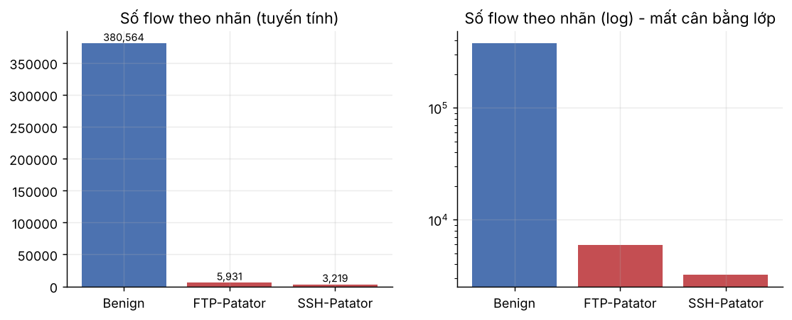
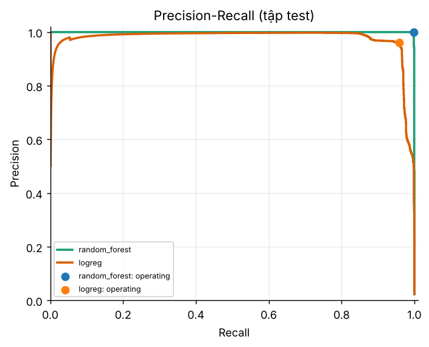
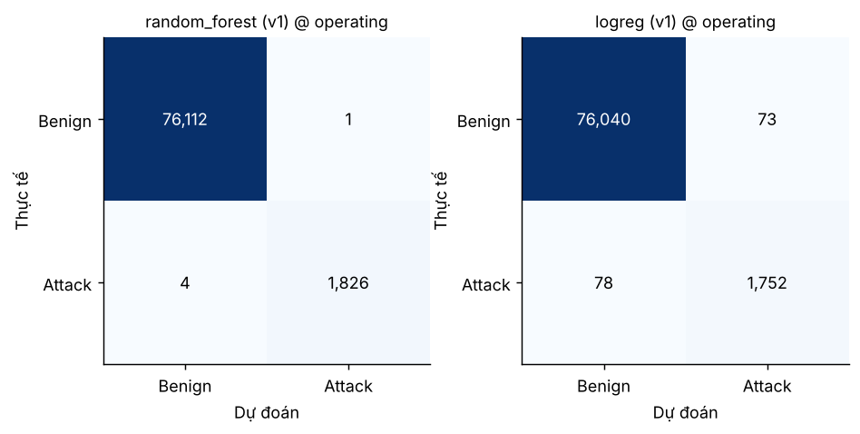
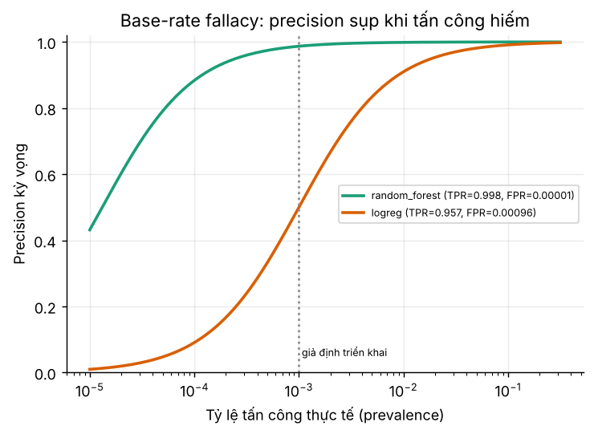
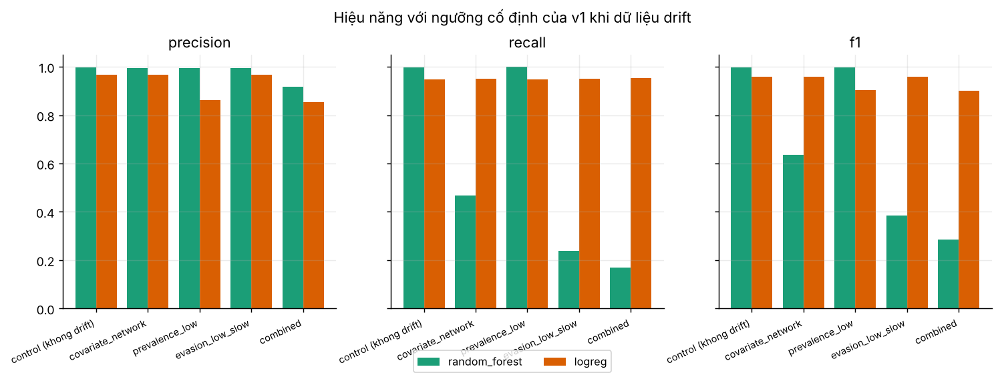
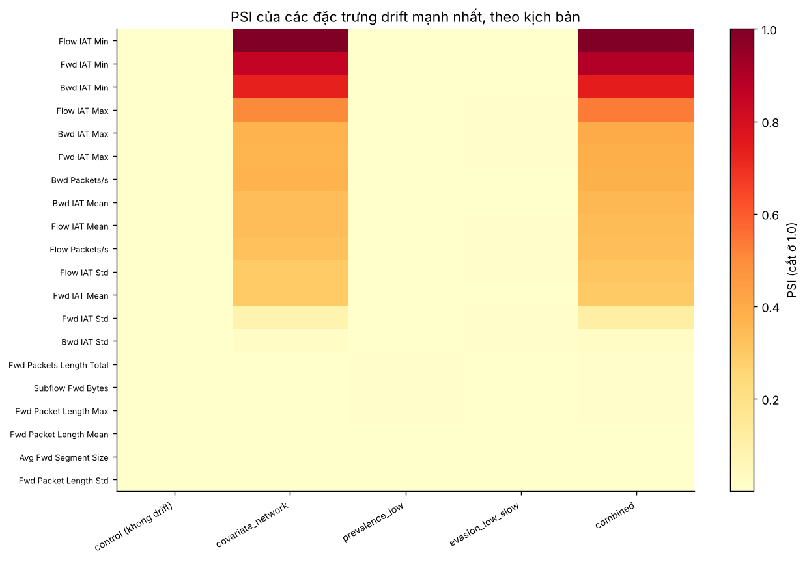
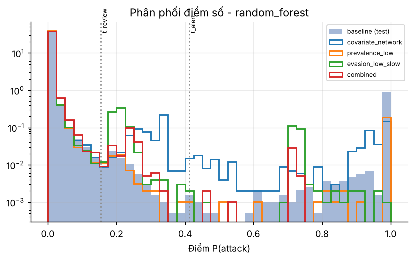
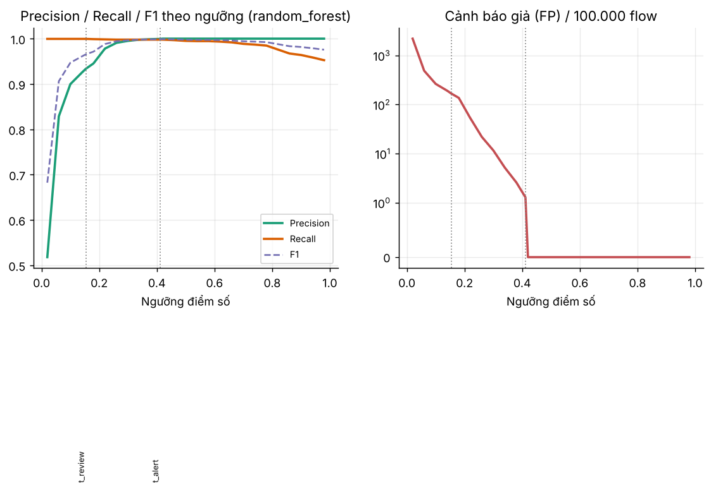
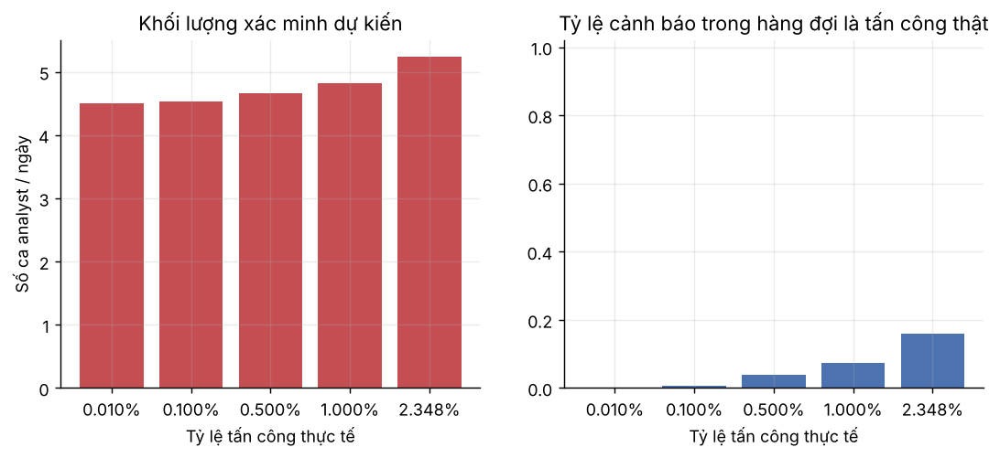
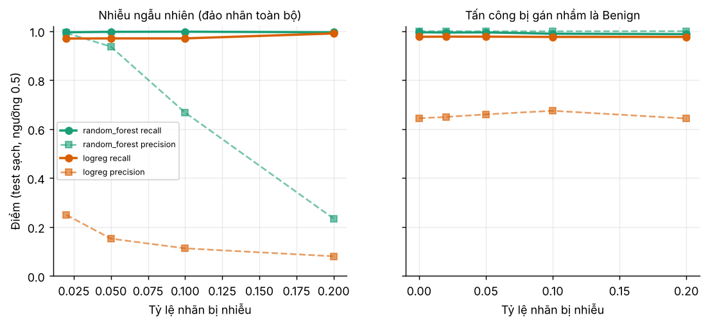

# Kết quả thực nghiệm (sinh tự động)

> File này do `experiments/build_report.py` tạo ra từ `results/tables/*.json`. Chạy lại pipeline sẽ cập nhật toàn bộ số liệu. Diễn giải và hạn chế: xem `docs/`.

## 1. Dữ liệu và cách chia tập

- 389,714 flow × 77 đặc trưng; nhãn: Benign=380,564, FTP-Patator=5,931, SSH-Patator=3,219.
- Tỷ lệ tấn công **2.35%** → bộ phân loại ‘luôn báo Benign’ đạt accuracy **97.65%** nhưng recall = 0. Vì vậy báo cáo dùng precision/recall/F1/FP thay vì accuracy.
- 10 đặc trưng hằng số (bị loại trong pipeline); NaN=0, Inf=0; 24 dòng trùng sau khi ép float32. Dữ liệu **không có timestamp** → chia ngẫu nhiên phân tầng (xem hạn chế).

| Tập | Số flow | Tỷ lệ tấn công | Fingerprint |
|---|---|---|---|
| train | 233828 | 2.348% | 32eb93a53ab2b773 |
| val | 77943 | 2.348% | 1d544940b69dbf73 |
| test | 77943 | 2.348% | ebc10d0e04817fd9 |

## 2. Hai mô hình cơ bản - đánh giá trên tập test

Mô hình: **random_forest** (mô hình chính) và **logreg** (mô hình phụ). Ngưỡng ‘operating’ = ngưỡng tối đa F1 chọn trên **validation** (không chọn trên test).

| Mô hình | Ver | Điểm vận hành | Ngưỡng | Precision | Recall | F1 | FP | FN | FP/100k flow | Accuracy |
|---|---|---|---|---|---|---|---|---|---|---|
| random_forest | v1 | default_0.5 | 0.5000 | 1.0000 | 0.9951 | 0.9975 | 0 | 9 | 0.0000 | 0.9999 |
| random_forest | v1 | operating(F1-max on val) | 0.4113 | 0.9995 | 0.9978 | 0.9986 | 1 | 4 | 1.2830 | 0.9999 |
| random_forest | v1 | t_alert | 0.4113 | 0.9995 | 0.9978 | 0.9986 | 1 | 4 | 1.2830 | 0.9999 |
| random_forest | v1 | t_review | 0.1539 | 0.9341 | 0.9995 | 0.9657 | 129 | 1 | 165.5056 | 0.9983 |
| random_forest | v1 | min_cost | 0.2199 | 0.9781 | 0.9984 | 0.9881 | 41 | 3 | 52.6025 | 0.9994 |
| logreg | v1 | default_0.5 | 0.5000 | 0.6443 | 0.9770 | 0.7765 | 987 | 42 | 1,266 | 0.9868 |
| logreg | v1 | operating(F1-max on val) | 0.9871 | 0.9600 | 0.9574 | 0.9587 | 73 | 78 | 93.6582 | 0.9981 |
| logreg | v1 | t_alert | 0.9995 | 0.9000 | 0.0098 | 0.0195 | 2 | 1812 | 2.5660 | 0.9767 |
| logreg | v1 | t_review | 0.0129 | 0.2255 | 1.0000 | 0.3681 | 6284 | 0 | 8,062 | 0.9194 |
| logreg | v1 | min_cost | 0.3930 | 0.5246 | 0.9962 | 0.6873 | 1652 | 7 | 2,119 | 0.9787 |

Baseline ‘luôn Benign’: accuracy=0.9765, recall=0.00, F1=0.00.

Recall theo loại tấn công (tại ngưỡng operating): random_forest: FTP-Patator=0.9992, SSH-Patator=0.9953; logreg: FTP-Patator=0.9907, SSH-Patator=0.8960.

Đặc trưng quan trọng nhất (top 5): random_forest: Bwd Header Length, Fwd Packet Length Std, Init Bwd Win Bytes, Packet Length Std, Subflow Bwd Packets; logreg: Packet Length Mean, Fwd Packet Length Max, Bwd Packet Length Mean, Avg Bwd Segment Size, Bwd Header Length.

## 3. Cảnh báo giả và ‘base-rate fallacy’

Precision đo trên tập test phụ thuộc vào tỷ lệ tấn công của tập đó. Nếu ngoài đời tấn công hiếm hơn, precision kỳ vọng (công thức Bayes từ recall và FPR đo được) giảm mạnh:

| Mô hình | p=0.010% | p=0.100% | p=1.000% | p=2.350% |
|---|---|---|---|---|
| random_forest | 0.8837 | 0.9870 | 0.9987 | 0.9995 |
| logreg | 0.0908 | 0.4998 | 0.9098 | 0.9600 |

FPR đo được dựa trên rất ít cảnh báo giả nên không chắc chắn. Với cận trên 95% của FPR (Clopper-Pearson) - random_forest: 1 FP/76,113 benign → FPR ≤ 6.23e-05; logreg: 73 FP/76,113 benign → FPR ≤ 1.17e-03 - precision kỳ vọng (kịch bản bi quan):

| Mô hình | p=0.010% | p=0.100% | p=1.000% | p=2.350% |
|---|---|---|---|---|
| random_forest | 0.6156 | 0.9413 | 0.9939 | 0.9974 |
| logreg | 0.0759 | 0.4513 | 0.8925 | 0.9519 |

## 4. Drift: tập dữ liệu thay đổi phân phối và giám sát

Cảnh báo: các tập dưới đây là **mô phỏng có kiểm soát** từ tập test, không phải lưu lượng thật.

| Kịch bản | Số flow | Số tấn công | Tỷ lệ | Tham số |
|---|---|---|---|---|
| covariate_network | 40000 | 939 | 2.348% | {"time_scale_median": 2.0, "time_scale_sigma": 0.3} |
| prevalence_low | 39257 | 196 | 0.499% | {"attack_prevalence": 0.005} |
| evasion_low_slow | 40000 | 939 | 2.348% | {"attack_time_scale_median": 8.0, "attack_time_scale_sigma": 0.3} |
| combined | 39257 | 196 | 0.499% | {"time_scale_median": 2.0, "time_scale_sigma": 0.3, "attack_time_scale_median": 8.0, "attack_time_scale_sigma": 0.3, "attack_prevalence": 0.005} |

| Kịch bản | Mô hình | Feature PSI≥ngưỡng | PSI dải điểm | Tỷ lệ dự đoán TC (so baseline) | Giám sát không nhãn | Precision | Recall | F1 | FP | Hiệu năng (có nhãn) | Drift im lặng |
|---|---|---|---|---|---|---|---|---|---|---|---|
| control (khong drift) | random_forest | 0/77 | 0.0000 | 1.0021 | STABLE | 0.9989 | 0.9968 | 0.9979 | 1 | OK | - |
| control (khong drift) | logreg | 0/77 | 0.0001 | 0.9882 | STABLE | 0.9674 | 0.9489 | 0.9581 | 30 | OK | - |
| covariate_network | random_forest | 17/77 | 0.0345 | 0.4706 | DRIFT | 0.9955 | 0.4665 | 0.6352 | 2 | DEGRADED | - |
| covariate_network | logreg | 17/77 | 0.0026 | 0.9915 | DRIFT | 0.9665 | 0.9510 | 0.9587 | 31 | OK | - |
| prevalence_low | random_forest | 0/77 | 0.0286 | 0.2147 | DRIFT | 0.9949 | 1.0000 | 0.9975 | 1 | OK | - |
| prevalence_low | logreg | 0/77 | 0.0257 | 0.2362 | DRIFT | 0.8611 | 0.9490 | 0.9029 | 30 | DEGRADED | - |
| evasion_low_slow | random_forest | 0/77 | 0.0664 | 0.2396 | DRIFT | 0.9955 | 0.2375 | 0.3835 | 1 | DEGRADED | - |
| evasion_low_slow | logreg | 0/77 | 0.0451 | 0.9904 | STABLE | 0.9675 | 0.9510 | 0.9592 | 30 | OK | - |
| combined | random_forest | 17/77 | 0.0771 | 0.0392 | DRIFT | 0.9167 | 0.1684 | 0.2845 | 3 | DEGRADED | - |
| combined | logreg | 17/77 | 0.0575 | 0.2394 | DRIFT | 0.8539 | 0.9541 | 0.9012 | 32 | DEGRADED | - |

Ngưỡng của mô hình được **đóng băng** ở giá trị chọn trên validation. ‘Giám sát không nhãn’ = PSI đặc trưng/dải điểm + tỷ lệ dự đoán tấn công; ‘hiệu năng (có nhãn)’ = F1 giảm quá ngưỡng so với nhóm control (không drift).

**Đọc kết quả:**

- `covariate_network` (random_forest): F1 0.998 → 0.635; recall 0.466; số feature có PSI vượt ngưỡng: 17/77; giám sát không nhãn: **DRIFT** (22% feature co PSI >= 0.25; ty le du doan tan cong x0.47 so voi baseline).
- `prevalence_low` (random_forest): F1 0.998 → 0.997; recall 1.000; số feature có PSI vượt ngưỡng: 0/77; giám sát không nhãn: **DRIFT** (ty le du doan tan cong x0.21 so voi baseline).
- `evasion_low_slow` (random_forest): F1 0.998 → 0.383; recall 0.237; số feature có PSI vượt ngưỡng: 0/77; giám sát không nhãn: **DRIFT** (ty le du doan tan cong x0.24 so voi baseline).
- `combined` (random_forest): F1 0.998 → 0.284; recall 0.168; số feature có PSI vượt ngưỡng: 17/77; giám sát không nhãn: **DRIFT** (22% feature co PSI >= 0.25; ty le du doan tan cong x0.04 so voi baseline).

## 5. Ngưỡng cảnh báo đề xuất và quy trình con người xác minh

Chính sách 3 vùng dựa trên **random_forest:v1** (ngưỡng chọn trên validation): `score ≥ 0.4113` → **ALERT**; `0.1539 ≤ score < 0.4113` → **REVIEW**; còn lại → **IGNORE** (ghi log + lấy mẫu audit). Mô hình phụ (logreg:v1) cho tín hiệu ‘đồng ý’ khi điểm ≥ 0.9871.

| Vùng | Số flow | Tỷ lệ | Tấn công thật | Benign (cảnh báo giả) | Precision vùng |
|---|---|---|---|---|---|
| alert | 1827 | 2.344% | 1826 | 1 | 0.9995 |
| review | 131 | 0.168% | 3 | 128 | 0.0229 |
| ignore | 75985 | 97.488% | 1 | 75984 | 0.0000 |

Chi phí kỳ vọng (FN=50, FP=1) trên test:

| Ngưỡng | Giá trị | FP | FN | Precision | Recall | Chi phí |
|---|---|---|---|---|---|---|
| default_0.5 | 0.5000 | 0 | 9 | 1.0000 | 0.9951 | 450 |
| operating | 0.4113 | 1 | 4 | 0.9995 | 0.9978 | 201 |
| t_alert | 0.4113 | 1 | 4 | 0.9995 | 0.9978 | 201 |
| t_review | 0.1539 | 129 | 1 | 0.9341 | 0.9995 | 179 |
| t_min_cost | 0.2199 | 41 | 3 | 0.9781 | 0.9984 | 191 |

### Hàng đợi xác minh (mô phỏng analyst)

| Hàng đợi | Số flow | Tỷ lệ | Tấn công thật | Precision thật |
|---|---|---|---|---|
| P1_alert | 1752 | 2.248% | 1752 | 1.0000 |
| P2_review | 206 | 0.264% | 77 | 0.3738 |
| P3_spotcheck | 15 | 0.019% | 0 | 0.0000 |
| P3_logged | 58 | 0.074% | 0 | 0.0000 |
| AUDIT | 78 | 0.100% | 0 | 0.0000 |
| ignore | 75834 | 97.294% | 1 | 0.0000 |

- Recall chỉ-máy (ngưỡng operating): **0.9978**; recall máy+người (analyst sai 3%): **0.9727**; nếu analyst hoàn hảo: 0.9995. Sai sót của analyst tự nó bỏ sót 49 tấn công → cần quy tắc 2 người duyệt khi bác bỏ cảnh báo điểm cao.
- Audit ngẫu nhiên 78 flow trong vùng bị bỏ qua: giới hạn phát hiện ≈ 3.8% (quy tắc ba). Số tấn công thật bị bỏ sót là 1 flow ≈ tỷ lệ nhỏ hơn nhiều giới hạn này → audit ngẫu nhiên **không** đủ để ước lượng tỷ lệ bỏ sót hiếm; cần audit phân tầng theo điểm số và săn mối đe dọa.

### Hàng đợi trên các kịch bản drift

| Kịch bản | Recall chỉ-máy | Recall máy+người | …nếu analyst hoàn hảo | Tỷ lệ flow vào hàng đợi người | Tấn công lọt vùng IGNORE | Tỷ lệ bất đồng 2 mô hình |
|---|---|---|---|---|---|---|
| control | 0.9968 | 0.9712 | 0.9989 | 2.515% | 1 | 0.075% |
| covariate_network | 0.4665 | 0.9681 | 0.9957 | 2.502% | 4 | 0.077% |
| prevalence_low | 1.0000 | 0.9847 | 1.0000 | 0.672% | 0 | 0.076% |
| evasion_low_slow | 0.2375 | 0.9521 | 0.9787 | 2.467% | 20 | 0.075% |
| combined | 0.1684 | 0.9337 | 0.9643 | 0.639% | 7 | 0.082% |

### Khối lượng analyst theo tỷ lệ tấn công thực tế (ngoại suy)

Giả định (sửa trong `configs/config.yaml`): 1,000,000 flow/ngày; 200 flow tấn công gộp thành 1 ticket; 3 flow cảnh báo giả gộp thành 1 ticket; 3.0 phút/ticket; ca 420 phút.

| Tỷ lệ tấn công | Ticket thật/ngày | Ticket giả/ngày | Ca analyst/ngày | Precision ticket | Precision mức flow |
|---|---|---|---|---|---|
| 0.010% | 0.4997 | 630.5782 | 4.5077 | 0.0008 | 0.0502 |
| 0.100% | 4.9973 | 630.0106 | 4.5358 | 0.0079 | 0.3459 |
| 0.500% | 24.9863 | 627.4881 | 4.6605 | 0.0383 | 0.7264 |
| 1.000% | 49.9727 | 624.3349 | 4.8165 | 0.0741 | 0.8422 |
| 2.348% | 117.3293 | 615.8346 | 5.2369 | 0.1600 | 0.9270 |

Với 2 ca analyst/ngày và tỷ lệ tấn công 0.10%, ngưỡng REVIEW ‘vừa sức’ thấp nhất là **0.2134** (recall test 0.9984, cần 1.63 ca/ngày); ngưỡng REVIEW theo mục tiêu recall cần 3.79 ca/ngày. Ngưỡng REVIEW khuyến nghị = max(hai ngưỡng) = **0.2134**.

## 6. Vòng đời: retrain, versioning, quality gate

Kịch bản kích hoạt: `evasion_low_slow`; dữ liệu feedback (nhãn trễ) trọng số ×5.0.

**random_forest** - quyết định: **PROMOTE** (ΔF1 trên drift = +0.619; thoái lui trên dữ liệu gốc = +0.001).

| Phương án | Precision (drift) | Recall (drift) | F1 (drift) | FP (drift) | F1 (dữ liệu gốc) |
|---|---|---|---|---|---|
| v1 (khong doi) | 1.0000 | 0.2306 | 0.3748 | 0 | 0.9986 |
| v1 + chinh lai nguong | 0.9729 | 0.9729 | 0.9729 | 14 | 0.9796 |
| v2 retrain | 1.0000 | 0.9884 | 0.9942 | 0 | 0.9978 |

Rollback drill: quay về v1 rồi promote lại v2 thành công.

**logreg** - quyết định: **PROMOTE** (ΔF1 trên drift = +0.009; thoái lui trên dữ liệu gốc = -0.014).

| Phương án | Precision (drift) | Recall (drift) | F1 (drift) | FP (drift) | F1 (dữ liệu gốc) |
|---|---|---|---|---|---|
| v1 (khong doi) | 0.9681 | 0.9399 | 0.9538 | 16 | 0.9587 |
| v1 + chinh lai nguong | 0.9681 | 0.9399 | 0.9538 | 16 | 0.9587 |
| v2 retrain | 0.9858 | 0.9399 | 0.9623 | 7 | 0.9726 |

Rollback drill: quay về v1 rồi promote lại v2 thành công.

## 7. Nhiễu nhãn trong dữ liệu huấn luyện (poisoning mức khái niệm)

| Loại nhiễu | Tỷ lệ | Mô hình | Precision | Recall | F1 | AP |
|---|---|---|---|---|---|---|
| attack_to_benign | 0% | logreg | 0.6443 | 0.9770 | 0.7765 | 0.9757 |
| attack_to_benign | 2% | logreg | 0.6496 | 0.9776 | 0.7805 | 0.9750 |
| attack_to_benign | 5% | logreg | 0.6601 | 0.9776 | 0.7881 | 0.9676 |
| attack_to_benign | 10% | logreg | 0.6748 | 0.9765 | 0.7981 | 0.9765 |
| attack_to_benign | 20% | logreg | 0.6433 | 0.9765 | 0.7756 | 0.9757 |
| attack_to_benign | 0% | random_forest | 0.9995 | 0.9956 | 0.9975 | 0.9997 |
| attack_to_benign | 2% | random_forest | 1.0000 | 0.9945 | 0.9973 | 0.9994 |
| attack_to_benign | 5% | random_forest | 0.9995 | 0.9951 | 0.9973 | 0.9996 |
| attack_to_benign | 10% | random_forest | 0.9994 | 0.9896 | 0.9945 | 0.9998 |
| attack_to_benign | 20% | random_forest | 1.0000 | 0.9880 | 0.9940 | 0.9994 |
| none | 0% | logreg | 0.6443 | 0.9770 | 0.7765 | 0.9757 |
| none | 0% | random_forest | 0.9995 | 0.9956 | 0.9975 | 0.9997 |
| uniform | 2% | logreg | 0.2496 | 0.9699 | 0.3970 | 0.9209 |
| uniform | 5% | logreg | 0.1527 | 0.9705 | 0.2639 | 0.8995 |
| uniform | 10% | logreg | 0.1130 | 0.9705 | 0.2024 | 0.8872 |
| uniform | 20% | logreg | 0.0807 | 0.9907 | 0.1492 | 0.8855 |
| uniform | 2% | random_forest | 0.9929 | 0.9956 | 0.9943 | 0.9989 |
| uniform | 5% | random_forest | 0.9369 | 0.9973 | 0.9661 | 0.9988 |
| uniform | 10% | random_forest | 0.6674 | 0.9978 | 0.7998 | 0.9978 |
| uniform | 20% | random_forest | 0.2349 | 0.9956 | 0.3802 | 0.9828 |

---
Xem `docs/06_results/conclusion.md` va `docs/04_design/` để biết giả định và hạn chế khi diễn giải các con số trên.